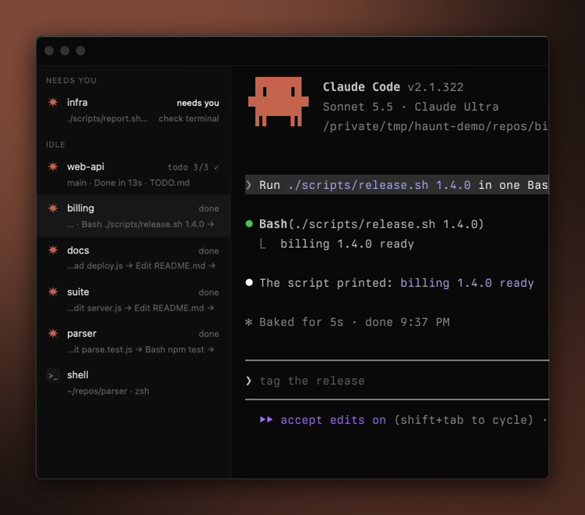

<div align="center">


# Live ticker

**A live ticker of each agent's tool calls on its Haunt row.**

[](https://github.com/highskore/haunt-hackathon)


[](LICENSE)



</div>

While an agent runs, its row's meta line ends with what it is doing right now, newest last:

```
web   feat/login · Read session.ts → Edit session.ts → Bash npm test →
```

Files show by name, commands by their first words. The line is cleared when a new prompt starts and when the turn ends, so you can follow several agents from the sidebar alone. The line holds up to 160 characters, or 64 with `scroll = false`, and the oldest steps drop off first. When the row is too narrow, Haunt shortens the meta first and then cuts the oldest steps from the start, so the newest step stays visible. While the agent needs you, Haunt's own status takes the row and the line is hidden.

## Settings

```toml
[plugins."dev.haunt.live-ticker"]
steps = 6                # calls kept on the line, 1 to 12
scroll = true            # a longer line, for scrolling (Haunt doesn't scroll it yet)
keep_after_stop = false  # keep the last calls after the turn ends
subagents = false        # include subagents' calls
unverified = false       # also show events without the tab's nonce
```

## Capabilities

| capability | why |
|---|---|
| `events` (prompt, tool, stop) | each call as it starts, and when a turn starts or ends |
| `decorate` | the line after the meta |
| `event_details` | the file path or command in each step; haunt asks in red, since commands can hold secrets |

Commands and paths come from the agent and are shown as plain text, with control and hidden characters removed. Events without the tab's nonce are ignored unless `unverified` is on.

## Build and test

```sh
cargo build --release --target wasm32-wasip2   # or ./build.sh
cargo test                                     # unit tests
haunt plugin install .
```

`e2e/live_ticker.rs` runs the built plugin against a real Haunt core: copy it into a Haunt checkout's `cli/tests/` and run `HAUNT_PLUGINS_DIR=<this repo's parent> cargo test -p haunt-cli --test live_ticker`.

Needs Haunt with plugin API 0.5 (`api = "0.5"`).

## Licence

MIT, see `LICENSE`.
